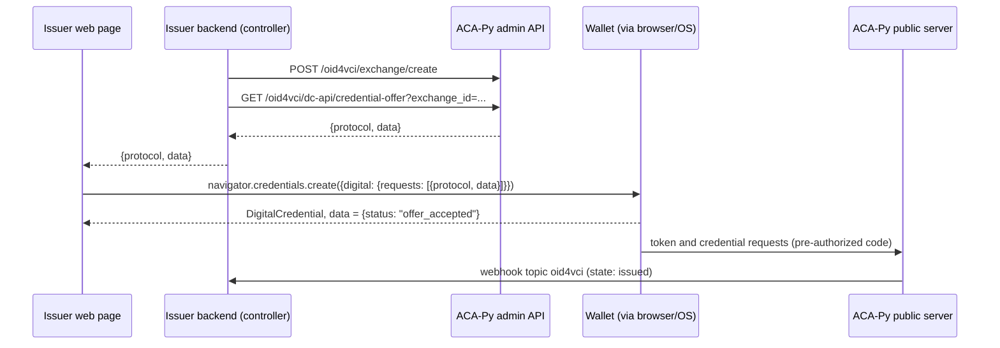

# OpenID4VCI over the W3C Digital Credentials API (experimental)

The plugin can produce credential offers for issuance through the
[W3C Digital Credentials API](https://www.w3.org/TR/digital-credentials/)
(DC-API): a web page passes the offer to `navigator.credentials.create()` and
the browser or operating system hands it to the user's wallet, instead of the
user scanning a QR code.

## Status

This is **experimental**. The W3C specification registers the issuance protocol
identifier `openid4vci-v1`, but OpenID4VCI does not yet define how it is used
with the DC-API; that work is tracked in
[OpenID4VCI issue #410](https://github.com/openid/OpenID4VCI/issues/410)
(milestone 1.1). The format here follows what browsers accept today (Chrome 155
and later, with an Android wallet) and the draft annex proposed in
[OpenID4VCI PR #476](https://github.com/openid/OpenID4VCI/pull/476): the
Credential Offer passed by value, with the Credential Issuer Metadata and
Authorization Server Metadata embedded so the wallet need not fetch them.
Expect field names to change as the specification settles. The OpenID4VC High
Assurance Interoperability Profile (HAIP 1.0) does not cover DC-API issuance.

## Flow



## Getting an offer

`GET /oid4vci/dc-api/credential-offer?exchange_id=<id>` (admin API) takes the
same exchange as `GET /oid4vci/credential-offer`, and creates the
pre-authorized code the same way. An exchange can be offered by QR code, by the
DC-API, or both; the first wallet to redeem the code receives the credential.

```json
{
  "protocol": "openid4vci-v1",
  "data": {
    "credential_issuer": "https://issuer.example",
    "credential_configuration_ids": ["UniversityDegree"],
    "grants": {
      "urn:ietf:params:oauth:grant-type:pre-authorized_code": {
        "pre-authorized_code": "..."
      }
    },
    "credential_issuer_metadata": {"credential_issuer": "https://issuer.example", "...": "..."},
    "authorization_server_metadata": {"issuer": "https://issuer.example", "token_endpoint": "https://issuer.example/token", "...": "..."}
  }
}
```

- `credential_issuer_metadata` is the document served at
  `/.well-known/openid-credential-issuer`.
- `authorization_server_metadata` is the document served at
  `/.well-known/oauth-authorization-server`. It is included only when ACA-Py is
  its own authorization server. With an external authorization server (for
  example the reference server or Keycloak) it is omitted, and the embedded
  issuer metadata lists the server under `authorization_servers`; wallets that
  require the authorization server metadata by value will not work with that
  setup yet.
- If the exchange requires a transaction code, the offer carries `tx_code` as
  usual and the page must show the code to the user.

## Calling the DC-API from the page

```js
const offer = await fetch("/dc-api/offer?exchange_id=...").then((r) => r.json());
try {
  const credential = await navigator.credentials.create({
    digital: { requests: [{ protocol: offer.protocol, data: offer.data }] },
  });
  // credential.data is the wallet's acknowledgement, not the credential.
} catch (err) {
  // NotSupportedError: no issuance support in this browser; offer the QR code.
  // NotAllowedError: cancelled, no suitable wallet, or no user gesture.
}
```

- Call `create()` from a user gesture (for example a click handler).
- `data` must be an object, not a JSON string.
- Feature detection with
  `DigitalCredential.userAgentAllowsProtocol("openid4vci-v1")` is not reliable
  on all browser versions; handle `NotSupportedError` and fall back to the QR
  code.
- The promise resolving means the wallet accepted the offer, not that the
  credential was issued. Issuance completes when the wallet calls the token and
  credential endpoints, reported by the usual `oid4vci` webhook (`issued`).

## Limitations

- Pre-authorized code flow only.
- Authorization Server Metadata is not embedded when an external authorization
  server is used (see above).
- No signed offers: none of the current drafts define them.
