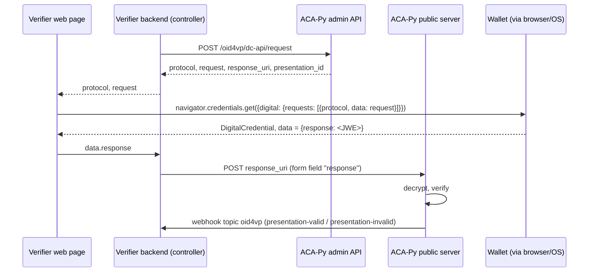

# OpenID4VP over the W3C Digital Credentials API

The plugin can create OpenID4VP requests for the
[W3C Digital Credentials API](https://www.w3.org/TR/digital-credentials/)
(DC-API), following
[OpenID4VP 1.0](https://openid.net/specs/openid-4-verifiable-presentations-1_0.html)
Appendix A. The browser (or OS credential manager) selects the wallet; there is
no QR code and no `request_uri` round trip.

- Requests use **DCQL** (the only query language in OpenID4VP 1.0).
- Responses are **always encrypted** (Response Mode `dc_api.jwt`, ECDH-ES).
- Requests can be **unsigned** (`openid4vp-v1-unsigned`) or **signed**
  (`openid4vp-v1-signed`, a JAR using the registered X.509 identity).

## Flow



## Creating a request

`POST /oid4vp/dc-api/request` (admin API):

| Field | Required | Description |
| --- | --- | --- |
| `dcql_query_id` | yes | A DCQL query created with `POST /oid4vp/dcql/queries`. |
| `vp_formats` | yes | Sent to the wallet as `client_metadata.vp_formats_supported`. Use the OpenID4VP 1.0 Appendix B format identifiers, e.g. `{"dc+sd-jwt": {"sd-jwt_alg_values": ["ES256"], "kb-jwt_alg_values": ["ES256"]}}`. |
| `expected_origins` | yes | Origins of the page making the call, e.g. `["https://verifier.example"]`. Bound into signed requests (A.2). The **first** origin defines the expected response audience `origin:<origin>` (A.4). |
| `signed` | no | `true` to sign the request with the X.509 identity registered via `POST /oid4vp/x509-identity` (Client Identifier Prefix `x509_san_dns`). |

Response:

```json
{
  "presentation_id": "…",
  "protocol": "openid4vp-v1-unsigned",
  "request": {
    "response_type": "vp_token",
    "response_mode": "dc_api.jwt",
    "nonce": "…",
    "client_metadata": {
      "vp_formats_supported": {"dc+sd-jwt": {"…": "…"}},
      "jwks": {"keys": [{"kty": "EC", "crv": "P-256", "x": "…", "y": "…", "kid": "…", "use": "enc", "alg": "ECDH-ES"}]},
      "encrypted_response_enc_values_supported": ["A128GCM", "A256GCM"]
    },
    "dcql_query": {"credentials": ["…"]}
  },
  "nonce": "…",
  "response_uri": "https://acapy.example/oid4vp/response/…",
  "vp_formats": {"…": "…"}
}
```

For signed requests `protocol` is `openid4vp-v1-signed`, `request` is
`{"request": "<compact JWS>"}`, and `client_id` is returned. The JAR carries
`client_id`, `expected_origins`, `aud: "https://self-issued.me/v2"` and the same
OpenID4VP parameters. `response_uri` is **not** sent to the wallet: it is where
the verifier forwards the response it gets back from the browser.

## Invoking the DC-API and returning the response

```js
// page
const r = await fetch("/dc-api/request").then((res) => res.json());
const credential = await navigator.credentials.get({
  digital: { requests: [{ protocol: r.protocol, data: r.request }] },
});
if (credential.data.error) {
  throw new Error(credential.data.error); // wallet error, returned unencrypted (A.4)
}
await fetch("/dc-api/response", {
  method: "POST",
  headers: { "Content-Type": "application/json" },
  body: JSON.stringify({ presentationId: r.presentation_id, response: credential.data.response }),
});
```

The verifier backend then posts the JWE to `response_uri` as the form field
`response` (`application/x-www-form-urlencoded`). The result arrives on the
`oid4vp` webhook topic, or can be read with `GET /oid4vp/presentation/{id}`.

For a DC-API presentation, `POST /oid4vp/response/{presentation_id}`:

- requires the encrypted `response` (an unencrypted `vp_token` is rejected);
- accepts one response per presentation;
- returns HTTP 400 without changing the presentation state when the JWE is
  malformed or encrypted to the wrong key, so a bad post cannot invalidate a
  pending presentation.

## Response encryption

Each request gets an ephemeral P-256 key. The public key is advertised in
`client_metadata.jwks` (`kid` = JWK SHA-256 thumbprint, `alg` = `ECDH-ES`,
`use` = `enc`). The private key is kept in wallet storage keyed by the
presentation id and is deleted after the response is decrypted. The wallet
encrypts with ECDH-ES direct key agreement and `A128GCM` or `A256GCM`
(OpenID4VP 1.0 Section 8.3, RFC 7518 Section 4.6).

In an **unsigned** request the encryption key is not integrity-protected, so a
script running in the verifier page could substitute it. Use signed requests
where that matters (W3C DC-API §11.3.1.7).

## ISO mdoc: fails closed

For mdoc, the device signature over the session transcript is the only binding
between a presentation, the holder's device key, the nonce and the verifier.
Over the DC-API that transcript is `OpenID4VPDCAPIHandover` (OpenID4VP 1.0
B.2.6.2), which the mdoc verifier does not implement yet, so device
authentication cannot succeed.

`POST /oid4vp/dc-api/request` therefore rejects a DCQL credential query for
`mso_mdoc` unless the query sets `"require_cryptographic_holder_binding": false`
(OpenID4VP 1.0 Section 6.1; the default is `true`). Setting it to `false`
explicitly accepts **issuer authentication only**: the data is genuine, but
nothing proves it was presented by the holder for this request.

For SD-JWT VC, the Key Binding JWT `aud` is checked against `origin:<origin>`
and its `nonce` against the request.

## Conformance

### OpenID4VP 1.0 Appendix A

Implemented:

- Protocol identifiers `openid4vp-v1-unsigned` and `openid4vp-v1-signed` (A.1).
- Response Mode `dc_api.jwt`; no `response_uri` or `state` in the request (A.2).
- `client_id` omitted in unsigned requests, present in signed requests (A.2).
- `expected_origins` in signed requests (A.2).
- Response audience `origin:<origin>` for signed and unsigned requests (A.4).
- DCQL query; `client_metadata.vp_formats_supported` (Section 5.1).
- Request Object `typ` `oauth-authz-req+jwt` and `aud`
  `https://self-issued.me/v2` (Sections 5 and 5.8).
- Encrypted responses as an unsigned JWE (Section 8.3).

Not implemented:

- Multi-signed requests (`openid4vp-v1-multisigned`, A.3.2.2).
- `transaction_data` and `verifier_info`.
- mdoc `OpenID4VPDCAPIHandover` (see above).
- Unencrypted `dc_api` responses (deliberately not offered).

### HAIP 1.0 (§5.2, OpenID4VP via the DC-API)

| Requirement | Status |
| --- | --- |
| Verifier uses Response Mode `dc_api.jwt` | ✅ |
| ECDH-ES on P-256; A128GCM and A256GCM supported and listed in `encrypted_response_enc_values_supported` | ✅ |
| Ephemeral encryption key per request in `client_metadata.jwks` | ✅ |
| DCQL query and response | ✅ |
| ES256 | ✅ |
| Signed requests use Client Identifier Prefix `x509_hash` | ❌ `x509_san_dns` only |
| DCQL `trusted_authorities` (`aki`) supported | ❌ not evaluated |
| Validate the mdoc `deviceSignature` | ❌ mdoc requires opting out of holder binding |

The X.509 profile rules (the trust anchor is not in `x5c`, the signing
certificate is not self-signed) depend on the chain registered with
`POST /oid4vp/x509-identity`.

### Limitations

- The response audience is checked against the **first** `expected_origins`
  entry only; serve the page from that origin.
- Encryption keys of requests that are never answered stay in wallet storage.
